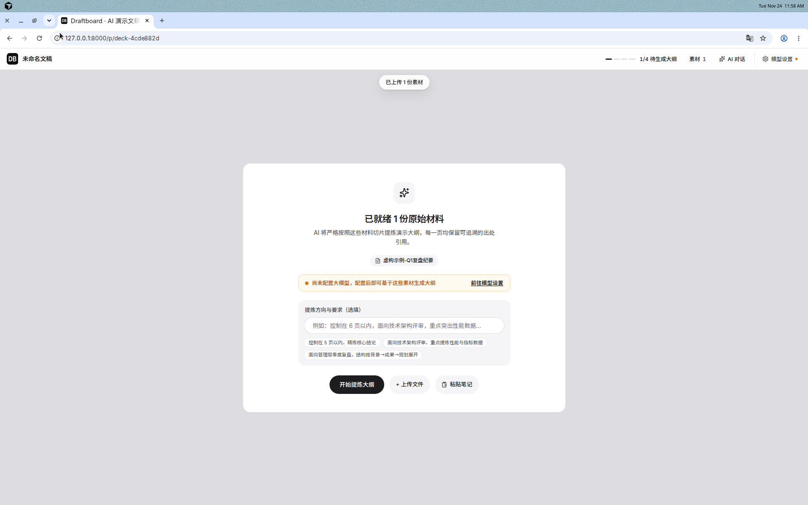
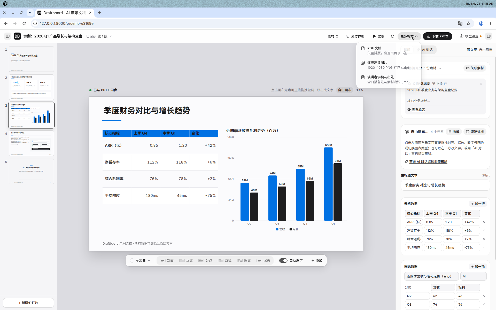
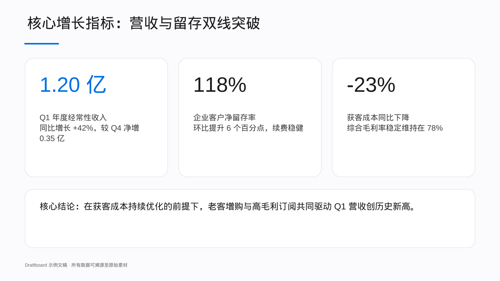
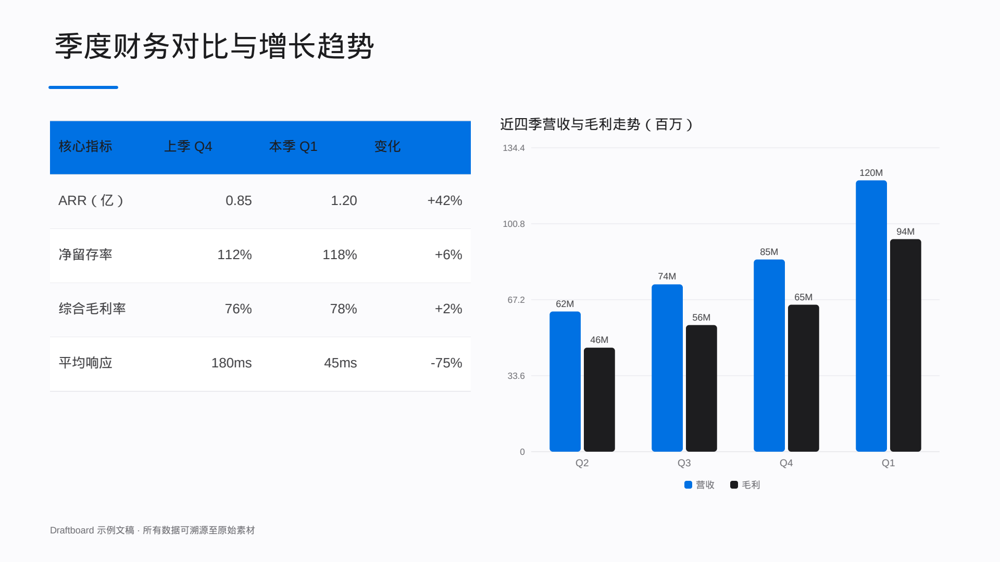

# Draftboard

A local workbench that turns source material into an editable PowerPoint deck. You import the material, review an outline that still points at those sources, and only then compile a PPTX. Layout is measured before the file is written. A configured model is required to draft an outline from your own material. The built-in example deck below does not call a model.

[](https://pypi.org/project/draftboard/)
[](LICENSE)
[](https://www.python.org/)
[](https://fastapi.tiangolo.com/)
[](https://nextjs.org/)

[English](README.md) | [简体中文](README_zh.md)

## What it does

1. **Import.** A project accepts `.md`, `.txt`, `.docx`, `.pdf`, `.csv`, `.xlsx`, `.pptx`, `.png`, and `.jpg`, plus a pasted note or a public URL. Files stay on disk under `~/.draftboard/projects` (override with `DRAFTBOARD_STORAGE_ROOT`).
2. **Outline.** With a model configured, the workbench drafts an outline from those materials. Each item keeps source ids. A page with no source can be marked as missing evidence. This step is not part of the sample below.
3. **Review.** You edit titles, summaries, layout, speaker notes, and source links before anything is compiled. Confirming an outline freezes that version. Later edits derive a new draft instead of rewriting the confirmed one.
4. **Compile.** `生成 PPTX` confirms the current draft and builds slides from it. The exporter measures each block against a real font file. Overflow or a missing glyph stops the export and reports the problem. The same run can also render a PDF, per-page PNGs, and a markdown speaker script with source excerpts.
5. **Edit and re-export.** After compile, the canvas and inspector edit the same outline. A new PPTX is reused only when the frozen inputs match: outline content, theme, brand, auto-fit, the bytes of images that deck references, and the export-rule version. The workbench asks `GET /api/projects/{id}/generation-sync` for that fingerprint.

Studio chat needs a configured model. Per-slide refine falls back to local rules when no key is set. Neither was used for the sample.

## Screenshots

These are the local UI from this repository, served at `http://127.0.0.1:8000`. No model key was set.

The import shot is a new project after pasting [the fictional brief](docs/examples/fictional-q1-brief.md). Outline generation stays blocked until a model is configured.



The other three shots are the built-in **体验示例**. That button writes a fixed fictional project and a draft outline. It does not call a model. `生成 PPTX` is the confirm-and-compile step.




## Run

Python 3.11 or newer. Continuous integration uses 3.12.

On Linux, measurement needs a Latin font and a CJK font. Windows uses Calibri and Microsoft YaHei when those files exist. If neither the defaults nor the variables below resolve, export stops with `Font file not found` and writes nothing.

```bash
export DRAFTBOARD_LATIN_FONT=/usr/share/fonts/truetype/liberation/LiberationSans-Regular.ttf
export DRAFTBOARD_EA_FONT=/usr/share/fonts/truetype/wqy/wqy-microhei.ttc
```

Debian and Ubuntu provide those paths with `fonts-liberation` and `fonts-wqy-microhei`. Any other real `.ttf` or `.ttc` paths work.

### This repository

The screenshots and the checked-in PPTX came from this tree, not from a separate hosted demo.

```bash
cd backend
uv sync
uv run draftboard serve
```

Open [http://127.0.0.1:8000](http://127.0.0.1:8000).

- Empty library: **10 秒体验示例文稿**. After the first project exists, the header button is **体验示例**.
- Read the five-slide outline. **生成 PPTX** confirms it and compiles.
- **下载 PPTX**, or open **更多格式** for PDF, a zip of PNGs, and the speaker script.

`pip install -e ./backend` and `draftboard serve` is the same server. The published one-liner below installs PyPI `draftboard` 0.0.9. Use the source checkout above to reproduce the files in this README.

```bash
uvx --python 3.12 draftboard@latest serve
# or: pip install draftboard && draftboard serve
```

Model keys are optional and only used for outline generation and chat. See [backend/.env.example](backend/.env.example). The example deck does not read them.

### Frontend

The server already embeds the built UI in `backend/src/draftboard/static`. Rebuild only when you change the Next.js app:

```bash
cd frontend
npm install
npm run dev      # http://localhost:3000, proxies /api/* to :8000
npm run build    # exports and copies the UI into backend/src/draftboard/static
```

### Tests

```bash
cd backend
uv run pytest tests/ -m "not integration" -v
```

That skips tests marked `integration`, which call a live model. Seven more cases skip unless Calibri and Microsoft YaHei exist at the default Windows font paths. The cases that run use synthetic fonts and do not read `DRAFTBOARD_LATIN_FONT` or `DRAFTBOARD_EA_FONT`.

## Sample files

Public fictional input, and a PPTX this app compiled from the built-in example. The numbers, customers, and architecture claims are made up.

| File | What it is |
| --- | --- |
| [docs/examples/fictional-q1-brief.md](docs/examples/fictional-q1-brief.md) | The note, with a fictional-sample banner on the first line. |
| [docs/examples/fictional-architecture.png](docs/examples/fictional-architecture.png) | The diagram the example endpoint draws with Pillow. Not a photograph and not a model image. |
| [docs/examples/fictional-q1-review.pptx](docs/examples/fictional-q1-review.pptx) | Editable 5-slide PPTX: text boxes, a native table, a native chart, one picture, and speaker notes. |

The in-app example writes the same note body **without** the banner line, plus the diagram, then saves an unconfirmed outline. The PPTX in this folder was produced by that project path: create the example, confirm the outline, compile. It was not produced by sending the markdown file to a model.

Opening the PPTX in PowerPoint or LibreOffice is the check that it is a real deck. These two PNGs are pages the app rendered from that file:





Repeat it:

1. Start `draftboard serve` as above, with the two font variables on Linux. Do not set an API key.
2. Click **体验示例**.
3. Click **生成 PPTX**, then **下载 PPTX**.

Pasting [the brief](docs/examples/fictional-q1-brief.md) only shows the import step. Turning that paste into an outline needs a configured model, which this sample does not use.

## Dependencies

Runtime: FastAPI, Uvicorn, Pydantic, python-pptx, Pillow, fonttools, pypdfium2, ReportLab, python-multipart, and `openai-agents` for the optional model calls. The UI is the bundled Next.js export. Preview rendering does not shell out to LibreOffice.

## Limits

- Drafting an outline from your own material, and the studio chat, need an API key or a local model such as Ollama. They were not used for the sample. Per-slide refine can run on local rules without a key; that path was not used either.
- The example deck is a fixed fixture. Its outline is written by the server, then compiled by the same exporter as a confirmed human outline.
- Export will not clip overflow. It fails the file instead.
- Projects are local. This repository does not deploy a public site.
- The workbench UI in the screenshots is the static bundle already in the repo. `npm run build` was not required to serve it.

## License

[Apache-2.0](LICENSE)
