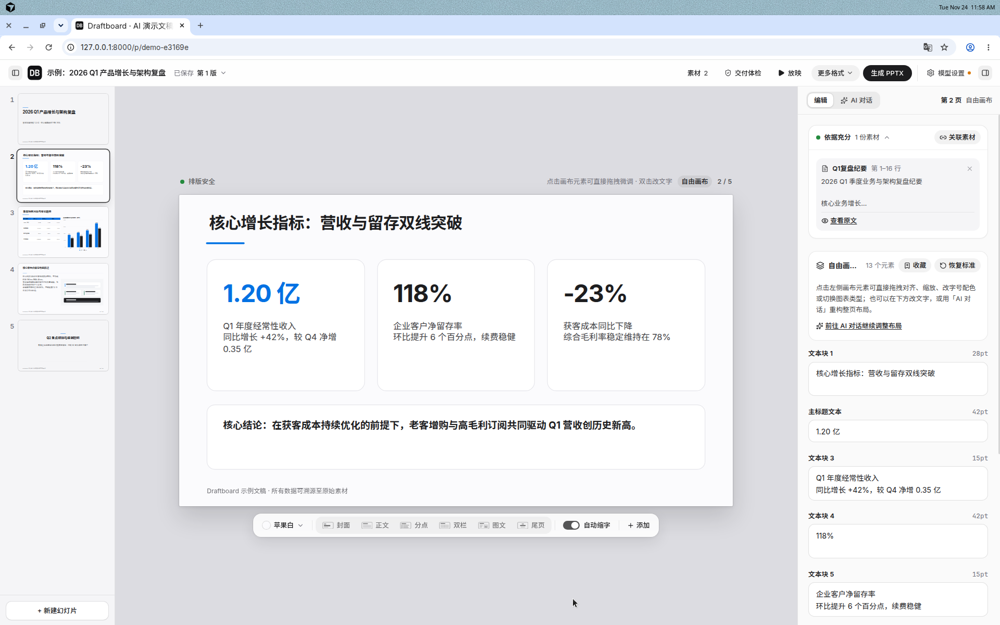
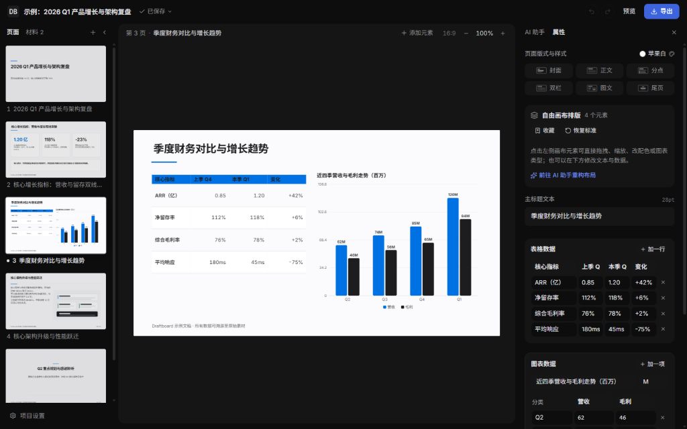

# Draftboard

Turn source materials into an editable PowerPoint deck — entirely on your machine.

[](https://github.com/lg114/draftboard/actions/workflows/ci.yml)
[](https://pypi.org/project/draftboard/)
[](LICENSE)
[](https://www.python.org/)
[](https://fastapi.tiangolo.com/)
[](https://nextjs.org/)

Import documents, spreadsheets, images, or web pages. Review an outline that still points back to those sources, then compile a real PPTX. Text is measured against real font files before export, so overflow or missing glyphs stop the process instead of silently clipping.

**You can try the built-in example without configuring any model.**

[English](README.md) | [简体中文](README_zh.md)

## What it solves

Most “AI slide generators” have two common problems:

1. It’s hard to trace where the content came from.
2. Layout frequently overflows, forcing manual fixes after export.

Draftboard works differently: it first builds an editable outline that keeps source references, lets you review and confirm it, then generates the PPTX. During export it measures every text block with real fonts so the layout stays under control.

Everything stays local. There is no public hosted version.

## Quick start (no model required)

```bash
uvx --python 3.12 draftboard@latest serve
```

(Or from a cloned repository, build the frontend once first — see [From source](#from-source-development).)

Open [http://127.0.0.1:8000](http://127.0.0.1:8000) and click **体验示例**.

Review the five-slide outline, then open **导出** and click **立即编译 PPTX** to confirm and compile. From the same **导出** menu you can download the PPTX, vector PDF, per-page PNGs (ZIP), and a markdown speaker script with source excerpts.

## How it works

1. **Import.** Accepts `.md`, `.txt`, `.docx`, `.pdf`, `.csv`, `.xlsx`, `.pptx`, `.png`, `.jpg`, pasted text, or a public URL. Files are stored locally under `~/.draftboard/projects` (override with `DRAFTBOARD_STORAGE_ROOT`).

2. **Outline (optional).** With a model configured, the workbench drafts an outline from the imported materials. Each slide keeps its source IDs. Pages without evidence can be marked as needing sources.

3. **Review.** Edit titles, summaries, layout, speaker notes, and source links before compiling. Confirming an outline freezes that version; later edits create a new draft instead of rewriting the confirmed one.

4. **Compile.** **生成 PPTX** confirms the current draft and builds the slides. The exporter measures every text block against a real font file — overflow or a missing glyph stops the export and reports the problem instead of clipping text. The same run can also produce a PDF, per-page PNGs, and a markdown speaker script with source excerpts.

5. **Edit and re-export.** After compiling, the canvas and inspector still edit the same outline. A previous PPTX is reused only when the frozen inputs match (outline content, theme, brand, auto-fit, the bytes of referenced images, and the export-rule version). The workbench checks this via `GET /api/projects/{id}/generation-sync`.

> Studio chat requires a configured model. Per-slide refine falls back to local rules when no key is set. Neither feature was used for the built-in example.

## Install & run

Python 3.11 or newer (CI uses 3.12).

### Fonts (Linux)

Text measurement needs a Latin font and a CJK font. On Windows the defaults are Calibri and Microsoft YaHei when those files exist.

```bash
export DRAFTBOARD_LATIN_FONT=/usr/share/fonts/truetype/liberation/LiberationSans-Regular.ttf
export DRAFTBOARD_EA_FONT=/usr/share/fonts/truetype/wqy/wqy-microhei.ttc
```

Debian/Ubuntu provide these via `fonts-liberation` and `fonts-wqy-microhei`. Any other real `.ttf` or `.ttc` paths work.

If no font is found, export fails with `Font file not found` and writes nothing.

### From PyPI (recommended, no Node.js required)

The published wheel already embeds the built Next.js UI:

```bash
uvx --python 3.12 draftboard@latest serve
# or
pip install draftboard && draftboard serve
```

### From source (development)

Built frontend assets (`backend/src/draftboard/static/`) are generated during packaging and not tracked in Git. When running from a fresh clone, build the UI once with Node.js 20+:

```bash
cd frontend && npm ci && npm run build
cd ../backend && uv sync && uv run draftboard serve
```

Or use `uv run draftboard serve --build` after `npm ci` to rebuild automatically before starting.

### Docker

The image bundles the built frontend and open-source TrueType Latin + CJK fonts (`fonts-liberation` and `fonts-wqy-microhei`), so no font configuration is required on Linux.

```bash
docker compose up -d --build
```

Open [http://127.0.0.1:8000](http://127.0.0.1:8000). Projects, model profiles, and saved custom layouts persist in the `draftboard_data` volume (`/data`). By default the port binds to `127.0.0.1:8000`; to reach a host-local Ollama instance from inside the container, use `http://host.docker.internal:11434/v1`.

Model keys are optional and only used for outline generation and chat. See [backend/.env.example](backend/.env.example). The example deck does not use them.

### Frontend development

```bash
cd frontend
npm ci
npm run dev      # http://localhost:3000, proxies /api/* to :8000
npm run build    # exports and copies into backend/src/draftboard/static
```

### Tests

```bash
cd backend
uv run pytest tests/ -m "not integration" -v
```

This skips `integration` tests that call a live model; offline tests use bundled synthetic fonts.

## Screenshots

Local dark-studio UI from this repository at `http://127.0.0.1:8000`.

Import step (materials attached, ready to draft an outline):


Built-in example (outline review, structured table/chart inspector, and unified export menu):






## Sample files

| File                                                                                | Description                                              |
| ----------------------------------------------------------------------------------- | -------------------------------------------------------- |
| [docs/examples/fictional-q1-brief.md](docs/examples/fictional-q1-brief.md)           | Fictional brief (banner on the first line)               |
| [docs/examples/fictional-architecture.png](docs/examples/fictional-architecture.png) | Diagram drawn with Pillow by the example endpoint        |
| [docs/examples/fictional-q1-review.pptx](docs/examples/fictional-q1-review.pptx)     | Editable 5-slide PPTX produced from the built-in example |

The PPTX in the repo was created by the path “create example → confirm outline → compile”, not by sending the markdown to a model. Open it in PowerPoint or LibreOffice to confirm it is a real deck. Below are two pages rendered directly from that file:


## Dependencies

Runtime: FastAPI, Uvicorn, Pydantic, python-pptx, Pillow, fonttools, pypdfium2, ReportLab, python-multipart, and `openai-agents` (optional).
The UI is the bundled Next.js export. Preview rendering does not shell out to LibreOffice.

## Limits

- Drafting an outline from your own materials, and studio chat, require an API key or a local model (e.g. Ollama). The built-in example does not.
- Export never clips overflow; it fails the file instead.
- Projects are local. This repository does not deploy a public site.
- The example deck is a fixed fixture. Its outline is written by the server, then compiled by the same exporter used for human-confirmed outlines.

## License

[Apache-2.0](LICENSE)
