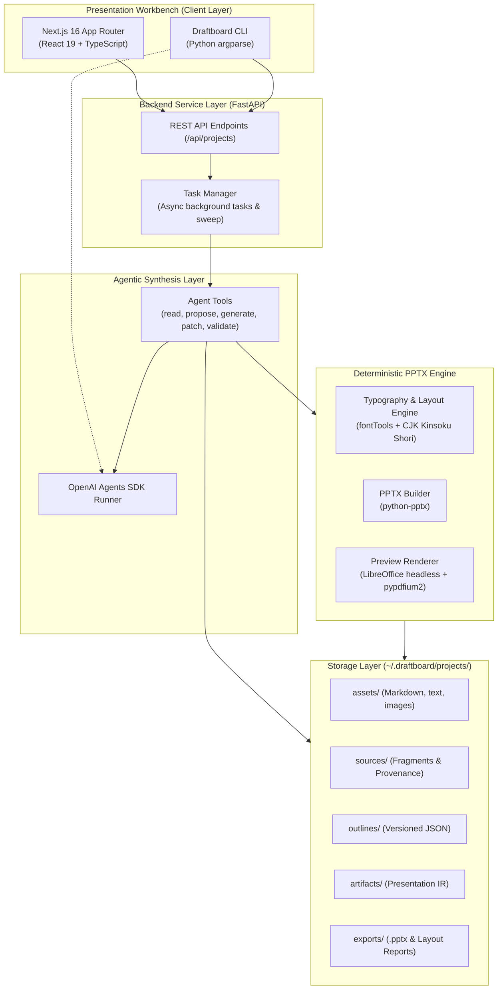

# Draftboard

<div align="center">

<p align="center">
  <strong>An AI Material-to-Presentation Creation Workbench with Agentic Rigor and Deterministic Layouts.</strong>
</p>

[](https://opensource.org/licenses/Apache-2.0)
[](https://www.python.org/)
[](https://fastapi.tiangolo.com/)
[](https://nextjs.org/)
[](https://github.com/openai/openai-agents-python)
[](https://github.com/your-org/draftboard/actions)

[English](README.md) | [简体中文](README_zh.md)

</div>

---

## 📖 Overview

**Draftboard** is a material-driven presentation creation workbench. Unlike traditional AI slide generators that hallucinate content or produce messy slide templates, Draftboard treats presentation generation as a disciplined compilation pipeline:

```
Raw Materials (.md / .txt / images)
  └─► Source Ingestion & Chunking (Fragments with strict provenance)
        └─► Agentic Outline Synthesis (OpenAI Agents SDK + Evidence citations)
              └─► Human Review & Versioned Branching (Interactive Outline Editor)
                    └─► Deterministic Typography & Layout Verification (fontTools)
                          └─► Native Editable PowerPoint (.pptx) + Visual Previews
```

Draftboard guarantees **evidence traceability**, **layout predictability (zero text overlap / overflow)**, and **human-in-the-loop control** over every slide before export.

---

## ✨ Key Highlights

### 1. 🛡️ Strict Provenance & Zero Fabrication
- **Verifiable Citations**: Every proposed outline item and slide element links back to concrete `SourceFragment` records from your uploaded files.
- **Evidence Confidence Tracking**: Claims carry an `evidence_status` (`supported`, `partial`, or `unsupported`), preventing the AI from elevating assumptions to facts.
- **Real Image Stubs**: Images are referenced via explicit `[image: filename]` handles; the agent cannot fabricate fictitious image assets.

### 2. 📐 Deterministic Typography & Layout Engine
- **Accurate Glyph Measurement**: Uses `fontTools` to read character advance widths directly from actual `.ttf`/`.otf` font files rather than rough character-length approximations.
- **Kinsoku Shori (禁则处理)**: Enforces East Asian and Latin typographic line-breaking rules. Opening punctuation (`(`, `《`, `“`) never ends a line; closing punctuation (`,`, `。`, `!`, `”`) never begins a line.
- **Dual-Font Typography**: Configurable primary Latin fonts seamlessly paired with native CJK fallback fonts.
- **Pre-Export Layout Verification**: Proactively detects `OVERFLOW`, `OVERLONG_WORD` (e.g. unbreakable URLs), and missing font glyphs, rejecting malformed slides before writing output.

### 3. 🔀 Versioned Human-in-the-Loop Outline Management
- **Candidate vs. Approved Outlines**: Outlines exist in candidate states (`v-<hash>`) until explicitly confirmed.
- **Safe Branching**: In-place edits update unconfirmed drafts. Modifying an already-confirmed outline branches into a fresh candidate version, ensuring the generated PPTX always matches what the human verified.

### 4. 🖥️ Full-Stack Modern Workbench
- **Next.js 16 Web UI**: Visual workspace featuring material upload, live drag/reorder outline editing, real-time background task polling, and instant PPTX downloads.
- **Visual Slide Previews**: High-fidelity slide previews rendered via headless LibreOffice and `pypdfium2`.
- **Unified Pipeline**: CLI commands and REST API endpoints execute the exact same tool and storage kernels.

### 5. ⚖️ Enterprise-Grade Licensing & Architecture
- **Apache-2.0 Licensed**: Business-friendly and compliant with enterprise policies.
- **Automated License Gate**: CI pipeline actively enforces a strict zero-AGPL/GPL/LGPL/non-commercial policy, producing a traceable SBOM seed (`THIRD_PARTY_LICENSES.md`).
- **Resilient Background Execution**: Long-running generation jobs persist status to disk with automatic recovery (`sweep_interrupted`) upon server reboot.

---

## 🏛️ Architecture




---

## 🚀 Quick Start

### Prerequisites

- **Python**: 3.11 or 3.12 (Python 3.12 recommended; pinned in CI)
- **Node.js**: 18+ (Node 20+ recommended)
- **Package Manager**: [uv](https://github.com/astral-sh/uv) (recommended for Python) and `npm`
- **LibreOffice** *(optional, for slide preview images)*: Install LibreOffice if you want local thumbnail previews.

### 1. Environment Configuration

Clone the repository and prepare your environment:

```bash
git clone https://github.com/your-org/draftboard.git
cd draftboard
```

Copy the environment template and set your OpenAI API key:

```bash
cp backend/.env.example backend/.env
```

Edit `backend/.env`:
```env
OPENAI_API_KEY=sk-your-openai-api-key
# Optional: Model selection (defaults to gpt-4o / gpt-4o-mini)
OPENAI_MODEL=gpt-4o
```

---

### 2. Running with Web UI (Recommended)

#### Start Backend API
```bash
cd backend
uv sync
uv run draftboard serve --port 8000
```
> The API server will be available at `http://127.0.0.1:8000`.

#### Start Frontend Workbench
In a new terminal window:
```bash
cd frontend
npm install
npm run dev
```
> Open your browser at **`http://localhost:3000`** to start using the workbench.

---

### 3. Using the CLI

Draftboard provides a robust, stand-alone CLI for terminal workflows and automated pipelines.

```bash
# 1. Initialize a new project directory (~/.draftboard/projects/my-demo/)
draftboard init my-demo

# 2. Add your markdown or image assets to ~/.draftboard/projects/my-demo/assets/
# e.g., cp ~/notes.md ~/.draftboard/projects/my-demo/assets/

# 3. Ask the agent to ingest materials and propose an outline
draftboard run "Read materials for project 'my-demo' and propose a structured outline"

# 4. View proposed outline versions
draftboard outline my-demo v-<version-hash>

# 5. Approve the outline (required before slide compilation)
draftboard confirm my-demo v-<version-hash>

# 6. Generate presentation slides
draftboard run "Generate slides for project 'my-demo'"

# 7. Export the generated artifact to an editable PPTX
draftboard export-deck my-demo <artifact_id>
```

---

## 🧪 Testing & Verification

Draftboard incorporates an exhaustive test suite covering data structures, atomic storage, typography rules, layout geometry, and full API cycles.

```bash
cd backend

# Run all offline unit tests (120+ tests, no API key required)
uv run pytest tests/ -m "not integration" -v

# Run typography and layout regression suite
uv run pytest tests/test_measure.py tests/test_regression_decks.py -v

# Run full integration tests (requires valid OPENAI_API_KEY)
uv run pytest tests/ -v
```

### Dependency License Gate
Every pull request is automatically verified against our open-source compliance policy:
```bash
# Inspect all licenses and regenerate report
uv run python -m piplicenses --format=markdown --output-file=THIRD_PARTY_LICENSES.md

# Verify zero copyleft / non-commercial dependencies
uv run python -m piplicenses \
  --fail-on "(AGPL|Affero|GNU General Public|GPLv[23]|GNU GPL|Lesser GPL|LGPL|non-commercial|NonCommercial|CC-BY-NC)"
```

---

## 🛠️ REST API Reference

| Endpoint | Method | Description |
|---|---|---|
| `/api/projects` | `GET` | List all existing workspace projects |
| `/api/projects` | `POST` | Create a new project scaffold (`{"project_id": "name"}`) |
| `/api/projects/{id}` | `GET` | Fetch project status, outlines, tasks, and exports |
| `/api/projects/{id}/materials` | `GET` | List uploaded material assets |
| `/api/projects/{id}/materials` | `POST` | Upload a new material (`.md`, `.txt`, `.png`, `.jpg`) |
| `/api/projects/{id}/outline/generate` | `POST` | Asynchronously trigger AI outline generation |
| `/api/projects/{id}/outlines/{v}` | `GET` | Get details for an outline version |
| `/api/projects/{id}/outlines/{v}` | `PUT` | Edit outline items (in-place or branch new candidate) |
| `/api/projects/{id}/outlines/{v}/confirm` | `POST` | Confirm outline approval |
| `/api/projects/{id}/generate` | `POST` | Asynchronously generate presentation and export PPTX |
| `/api/projects/{id}/tasks/{task_id}` | `GET` | Poll background task status (`running`, `succeeded`, `failed`) |
| `/api/projects/{id}/download` | `GET` | Download the latest successfully generated `.pptx` |
| `/api/projects/{id}/preview` | `GET` | Retrieve rendered slide preview image URLs |
| `/api/projects/{id}/preview/render` | `POST` | Force re-render slide preview images |

---

## 📋 Design Principles

1. **No Hallucination or Semantic Inflation**: The AI cannot upgrade hypothetical ideas into facts; unsupported claims are tagged `unsupported`.
2. **Deterministic Over Heuristic**: Slide geometry and text wrapping must be verifiable via physical font metrics before file creation.
3. **Fail-Closed on Layout Errors**: If text overflows the bounding box or contains unbreakable tokens that ruin visual aesthetics, the pipeline aborts with structured issues rather than generating broken slides.
4. **Idempotence & Concurrency Control**: All modification tools take revision identifiers and idempotency keys to prevent race conditions during collaborative editing.

---

## 📄 License

Draftboard is open-source software licensed under the **[Apache-2.0 License](LICENSE)**.
Third-party dependency licenses are audited and tracked in **[THIRD_PARTY_LICENSES.md](backend/THIRD_PARTY_LICENSES.md)**.
