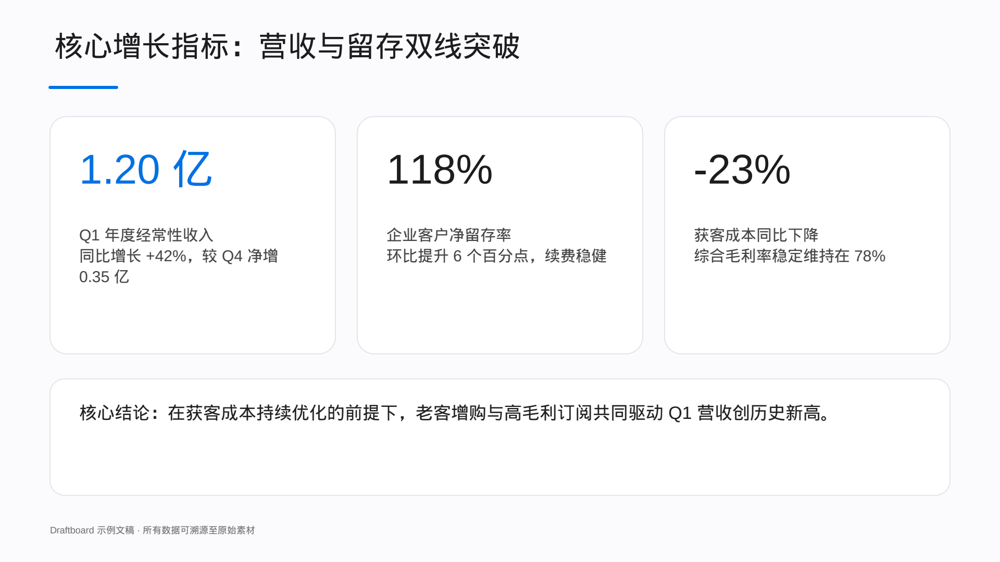

# Draftboard

把材料变成可编辑的 PPT，全程在你自己的电脑上完成。

[](https://github.com/lg114/draftboard/actions/workflows/ci.yml)
[](https://pypi.org/project/draftboard/)
[](LICENSE)
[](https://www.python.org/)
[](https://fastapi.tiangolo.com/)
[](https://nextjs.org/)

导入文档、表格、图片或网页内容，先生成并审阅一份带出处的大纲，确认后再编译成真正的 PowerPoint 文件。导出前会用真实字体测量每一块文字，放不下或缺少字形时直接报错，而不是悄悄把字切掉。

**不用配置模型也能先体验**，内置示例可以直接生成一份完整的 5 页 PPT。

[English](README.md) | [简体中文](README_zh.md)

## 它解决什么问题

大多数“AI 生成 PPT”工具有两个常见问题：

1. 生成后很难追溯内容从哪来；
2. 排版经常溢出，导出后还要手动修。

Draftboard 的做法是：先把材料整理成可编辑的大纲（每一页都保留来源），你确认无误后再生成 PPTX。生成时用真实字体做测量，确保版面可控。

所有内容都存在本地，没有公开的在线版本。

## 快速体验（不需要模型）

```bash
cd backend
uv sync
uv run draftboard serve
```

打开 [http://127.0.0.1:8000](http://127.0.0.1:8000)，点击 **体验示例**。

看完 5 页大纲后，点右上角 **导出 → 立即编译 PPTX** 即可确认并编译。随后可在同一个 **导出** 菜单里下载 PPTX、矢量 PDF、逐页高清 PNG（ZIP）以及带出处摘录的 Markdown 讲稿。

## 完整流程

1. **导入材料**  
   支持 `.md`、`.txt`、`.docx`、`.pdf`、`.csv`、`.xlsx`、`.pptx`、`.png`、`.jpg`，也可以直接粘贴文本或抓取公开网页。  
   文件保存在本机 `~/.draftboard/projects`（可用环境变量 `DRAFTBOARD_STORAGE_ROOT` 修改）。

2. **生成大纲**（可选）  
   配置模型后，会根据材料起草大纲。每一页都保留来源 ID，没有依据的页面可以标记为“待补依据”。

3. **审阅与修改**  
   编译前可以自由修改标题、摘要、版式、演讲者备注和出处链接。  
   确认后这一版会被冻结。之后再改会生成新草稿，而不会覆盖已确认的版本。

4. **编译导出**  
   点击「生成 PPTX」会确认当前草稿并生成幻灯片。  
   导出时用真实字体文件测量每个文本块，一旦溢出或缺少字形就停止并报错，不会截断文字。  
   同一次编译还可以同时得到 PDF、逐页 PNG，以及带出处摘录的 Markdown 讲稿。

5. **后续修改与再次导出**  
   编译后仍可在画布和检查器里继续编辑同一份大纲。  
   只有当大纲内容、主题、品牌设置、自动缩字、引用的图片字节以及导出规则版本都一致时，才会复用上一份 PPTX（工作台通过 `GET /api/projects/{id}/generation-sync` 校验这套指纹）。

> 工作台对话需要配置模型。单页精修在没有密钥时会回退到本地规则。内置示例没有使用这两项功能。

## 安装与运行

需要 Python 3.11 或更高版本（CI 使用 3.12）。

### 字体要求（Linux）

测量文字需要西文字体和中文字体。Windows 默认使用 Calibri 和微软雅黑。

```bash
export DRAFTBOARD_LATIN_FONT=/usr/share/fonts/truetype/liberation/LiberationSans-Regular.ttf
export DRAFTBOARD_EA_FONT=/usr/share/fonts/truetype/wqy/wqy-microhei.ttc
```

Debian/Ubuntu 可通过 `fonts-liberation` 和 `fonts-wqy-microhei` 安装。其他真实的 `.ttf` / `.ttc` 路径也可以。

找不到字体时，导出会报 `Font file not found` 并中止，不会生成残缺文件。

### 从源码运行（推荐）

```bash
cd backend
uv sync
uv run draftboard serve
```

也可以：

```bash
pip install -e ./backend
draftboard serve
```

### 从 PyPI 安装

```bash
uvx --python 3.12 draftboard@latest serve
# 或
pip install draftboard && draftboard serve
```

### Docker 部署

镜像已内置构建好的前端界面与开源 TrueType 中英文字体（`fonts-liberation` + `fonts-wqy-microhei`），在 Linux 上无需手动配置字体路径。

```bash
docker compose up -d --build
```

打开 [http://127.0.0.1:8000](http://127.0.0.1:8000)。项目数据、模型配置和收藏版式统一持久化在 `draftboard_data` 数据卷（`/data`）中。端口默认仅绑定到本机 `127.0.0.1:8000`；如需在容器内连接宿主机运行的 Ollama，接口地址填 `http://host.docker.internal:11434/v1`。

模型密钥只用于大纲生成和对话，可不配。配置方式见 [backend/.env.example](backend/.env.example)。

### 前端开发（可选）

服务已内置打包好的界面。只有修改 Next.js 前端时才需要重新构建：

```bash
cd frontend
npm install
npm run dev      # http://localhost:3000，API 代理到 :8000
npm run build    # 构建后自动复制到 backend/src/draftboard/static
```

### 测试

```bash
cd backend
uv run pytest tests/ -m "not integration" -v
```

该命令会跳过调用真实模型的 `integration` 用例，离线单测使用测试自带的合成字体。

## 界面预览

以下截图均来自本仓库本地运行的暗色工作台界面（`http://127.0.0.1:8000`）。

导入材料与输入要求：


内置体验示例的大纲审阅、图表/表格属性编辑与导出菜单：


## 示例文件

| 文件 | 说明 |
| --- | --- |
| [docs/examples/fictional-q1-brief.md](docs/examples/fictional-q1-brief.md) | 虚构纪要原文（首行有示例标注） |
| [docs/examples/fictional-architecture.png](docs/examples/fictional-architecture.png) | 用 Pillow 绘制的示意图 |
| [docs/examples/fictional-q1-review.pptx](docs/examples/fictional-q1-review.pptx) | 由体验示例编译出的 5 页可编辑 PPTX |

仓库中的 PPTX 是通过「创建体验示例 → 确认大纲 → 编译」这条路径生成的，并非把 Markdown 直接丢给模型得到。用 PowerPoint 或 LibreOffice 打开即可验证它是真实的演示文稿。下面两张是应用直接从该文件渲染出的页面：




## 依赖

运行时主要依赖：FastAPI、Uvicorn、Pydantic、python-pptx、Pillow、fonttools、pypdfium2、ReportLab、python-multipart，以及可选的 `openai-agents`。

界面是已打包的 Next.js 静态资源。预览渲染不依赖 LibreOffice。

## 限制与说明

- 用自己的材料生成大纲、以及工作台对话，需要 API 密钥或本地模型（如 Ollama）。内置示例不需要。
- 导出时不会截断溢出文字，而是直接失败，保证版面准确。
- 所有项目都存在本地，本仓库不提供公开部署版本。
- 示例文稿是固定内容，大纲由服务直接写入，再经过与人工确认大纲相同的导出流程编译。

## 开源协议

[Apache-2.0](LICENSE)
