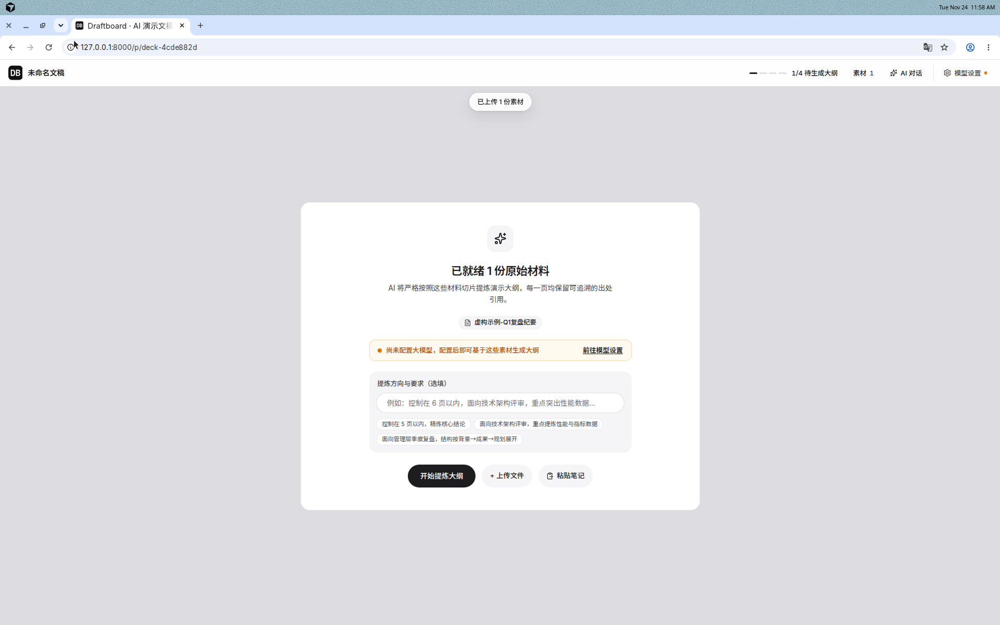
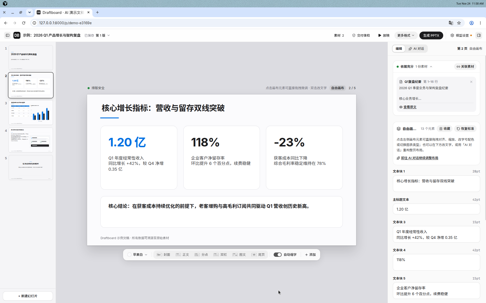
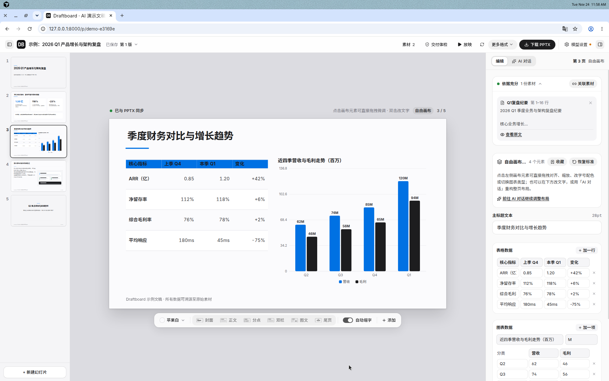
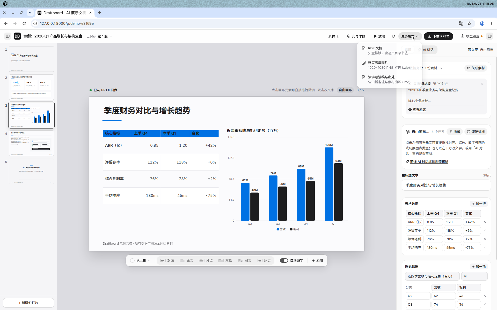
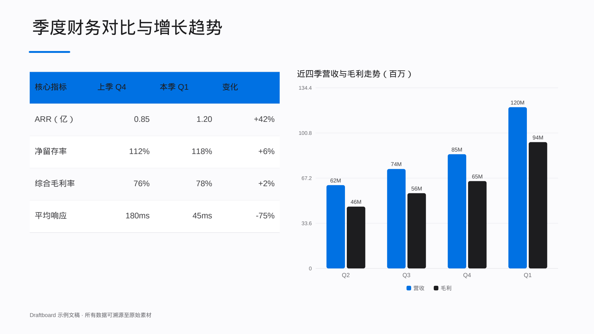

# Draftboard

本地幻灯片工作台：导入材料，审阅仍指向这些材料的大纲，确认后再编译成可编辑的 PowerPoint。写出文件之前会按真实字体测量版面。用自己的材料起草大纲需要已配置的模型。下面的内置示例不调用模型。

[](https://pypi.org/project/draftboard/)
[](LICENSE)
[](https://www.python.org/)
[](https://fastapi.tiangolo.com/)
[](https://nextjs.org/)

[English](README.md) | [简体中文](README_zh.md)

## 实际闭环

1. **导入。** 项目接受 `.md`、`.txt`、`.docx`、`.pdf`、`.csv`、`.xlsx`、`.pptx`、`.png`、`.jpg`，也可以粘贴笔记或抓取公开网页。文件留在本机 `~/.draftboard/projects`（可用 `DRAFTBOARD_STORAGE_ROOT` 改位置）。
2. **大纲。** 配置模型后，工作台根据这些材料起草大纲。每一页保留素材 id。没有出处的页可以标成待补依据。这一步不在下面的样例里。
3. **审阅。** 编译前可以改标题、摘要、版式、讲稿备注和出处。确认会冻住这一版。之后再改会派生新草稿，不改写已确认的版本。
4. **编译。** 「生成 PPTX」会确认当前草稿，并按大纲生成幻灯片。导出器用真实字体文件测量每个文本块。放不下或缺少字形时，导出停住并给出问题，不截断文字。同一次编译还可以得到 PDF、逐页 PNG，以及带出处摘录的 Markdown 讲稿。
5. **编辑后再导出。** 编译之后，画布和检查器改的仍是同一份大纲。只有冻结输入一致时才复用上一份 PPTX：大纲内容、主题、品牌、自动缩字、该文稿实际引用的图片字节，以及导出规则版本。工作台用 `GET /api/projects/{id}/generation-sync` 读取这套指纹。

工作台对话需要已配置的模型。单页精修在没有密钥时会退回本地规则。样例没有使用这两处。

## 界面

下面是本仓库在 `http://127.0.0.1:8000` 的本地界面。没有配置模型密钥。

导入图是新建文稿并粘贴 [虚构纪要](docs/examples/fictional-q1-brief.md) 之后。在配置模型之前，不能从这份材料生成大纲。



另外三张是内置「体验示例」。这个按钮写入一份固定的虚构项目和未确认大纲，不调用模型。「生成 PPTX」就是确认并编译。







## 运行

Python 3.11 及以上。持续集成使用 3.12。

在 Linux 上，测量需要一个西文字体和一个中文字体。Windows 在本机有 Calibri 和微软雅黑时用这两个文件。默认路径和环境变量都找不到字体时，导出会报 `Font file not found`，并且不会写出文件。

```bash
export DRAFTBOARD_LATIN_FONT=/usr/share/fonts/truetype/liberation/LiberationSans-Regular.ttf
export DRAFTBOARD_EA_FONT=/usr/share/fonts/truetype/wqy/wqy-microhei.ttc
```

Debian 和 Ubuntu 上，这两个路径分别来自 `fonts-liberation` 和 `fonts-wqy-microhei`。换成其他真实的 `.ttf` 或 `.ttc` 也可以。

### 本仓库

截图和仓库里的 PPTX 来自这份源码，不是单独部署的演示站。

```bash
cd backend
uv sync
uv run draftboard serve
```

打开 [http://127.0.0.1:8000](http://127.0.0.1:8000)。

- 文稿库为空时，按钮是 **10 秒体验示例文稿**。已有文稿后，顶栏按钮是 **体验示例**。
- 阅读这 5 页大纲。**生成 PPTX** 会确认并编译。
- **下载 PPTX**。**更多格式** 里还有 PDF、PNG 压缩包和讲稿。

`pip install -e ./backend` 然后 `draftboard serve` 是同一个服务。下面的发布包命令安装的是 PyPI 上的 `draftboard` 0.0.9。要复现本说明里的文件，用上面的源码启动。

```bash
uvx --python 3.12 draftboard@latest serve
# 或：pip install draftboard && draftboard serve
```

模型密钥只用于大纲生成和对话，可以不配。见 [backend/.env.example](backend/.env.example)。示例文稿不读取它们。

### 前端

服务已经带上 `backend/src/draftboard/static` 里的界面。只有改 Next.js 应用时才需要重新构建：

```bash
cd frontend
npm install
npm run dev      # http://localhost:3000，把 /api/* 代理到 :8000
npm run build    # 导出并复制到 backend/src/draftboard/static
```

### 测试

```bash
cd backend
uv run pytest tests/ -m "not integration" -v
```

这会跳过标记为 `integration` 的测试，那些测试会调用真实模型。另外有 7 个用例在默认的 Windows 字体路径上找不到 Calibri 和微软雅黑时跳过。实际会跑的用例使用测试自带的合成字体，不读取 `DRAFTBOARD_LATIN_FONT` 或 `DRAFTBOARD_EA_FONT`。

## 样例文件

公开的虚构输入，以及本应用从内置示例编译出的 PPTX。其中的金额、客户和架构描述都是编造的。

| 文件 | 是什么 |
| --- | --- |
| [docs/examples/fictional-q1-brief.md](docs/examples/fictional-q1-brief.md) | 纪要正文。第一行是虚构示例标注。 |
| [docs/examples/fictional-architecture.png](docs/examples/fictional-architecture.png) | 示例接口用 Pillow 画的示意图。不是照片，也不是模型生成的图。 |
| [docs/examples/fictional-q1-review.pptx](docs/examples/fictional-q1-review.pptx) | 可编辑的 5 页 PPTX：文本框、原生表格、原生图表、一张图片，以及演讲者备注。 |

应用内示例写入的是**不含**首行标注的同一份纪要正文，外加这张示意图，然后保存未确认大纲。本目录中的 PPTX 来自这条路径：创建示例、确认大纲、编译。它不是把这份 Markdown 发给模型得到的。

用 PowerPoint 或 LibreOffice 打开 PPTX，可以确认它是真实的演示文稿。下面两张 PNG 是应用从该文件渲染出的页面：




复现：

1. 按上面的方式启动 `draftboard serve`。Linux 上先设置两个字体变量。不要设置 API 密钥。
2. 点击 **体验示例**。
3. 点击 **生成 PPTX**，再点 **下载 PPTX**。

粘贴 [这份纪要](docs/examples/fictional-q1-brief.md) 只会走到导入。要把它变成大纲，需要配置模型。本样例不使用那条路径。

## 依赖

运行时：FastAPI、Uvicorn、Pydantic、python-pptx、Pillow、fonttools、pypdfium2、ReportLab、python-multipart，以及可选模型调用所用的 `openai-agents`。界面是已打包的 Next.js 导出。预览渲染不调用 LibreOffice。

## 限制

- 用自己的材料起草大纲，以及工作台对话，需要 API 密钥或本地模型（例如 Ollama）。样例没有使用它们。单页精修在没有密钥时可以走本地规则；这条路径也没有使用。
- 示例文稿是固定夹具。大纲由服务写入，再经过与人工确认大纲相同的导出器编译。
- 导出不会把溢出文字截断，而是让这次导出失败。
- 项目存在本机。本仓库不部署公开站点。
- 截图里的界面是仓库里已有的静态包。提供这些截图时没有运行 `npm run build`。

## 开源协议

[Apache-2.0](LICENSE)
