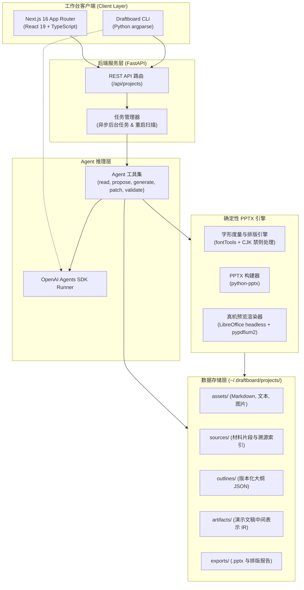

# Draftboard

<div align="center">

<p align="center">
  <strong>基于 Agent 严密推理与确定性版面引擎的 AI 材料创作工作台</strong>
</p>

[](https://opensource.org/licenses/Apache-2.0)
[](https://www.python.org/)
[](https://fastapi.tiangolo.com/)
[](https://nextjs.org/)
[](https://github.com/openai/openai-agents-python)
[](https://github.com/your-org/draftboard/actions)

[English](README.md) | [简体中文](README_zh.md)

</div>

---

## 📖 项目简介

**Draftboard** 是一套面向专业材料的演示文稿（PPT）创作工作台。区别于常见的“输入一句话就盲目幻觉并套用模板”的工具，Draftboard 将 PPT 的生成视作一个严密的**编译管线**：

```
原始材料 (.md / .txt / 图片)
  └─► 来源摄取与切分 (SourceFragment，带有可追溯的行号和 ID)
        └─► Agent 大纲推理 (OpenAI Agents SDK + 严格的证据引用与置信度标注)
              └─► 人机协同审阅与版本分支 (Web 可视化大纲编辑器，支持移动与修改)
                    └─► 确定性版面引擎与字形测量 (fontTools + 中西文禁则处理)
                          └─► 原生可编辑 PowerPoint (.pptx) + 渲染预览
```

Draftboard 核心保障**三大支柱**：**材料依据可溯源（绝不虚构）**、**版面确定性（绝不溢出、绝不重叠）**以及**人在回路（未经用户确认绝不生成 PPT）**。

---

## ✨ 核心特性

### 1. 🛡️ 严格溯源与零虚构原则 (Zero Fabrication)
- **精准来源引用**：大纲和幻灯片的每个要点都显式引用上传材料的 `SourceFragment` 切片。
- **证据置信度标记**：每个要点携带 `evidence_status`（`supported` 充分支持 / `partial` 部分支持 / `unsupported` 无材料支持），禁止模型脑补事实。
- **真实图片存根**：图片仅生成 `[image: filename]` 占位，AI 不得捏造不存在的图片资产。

### 2. 📐 确定性排版与几何度量引擎
- **物理字形度量**：通过 `fontTools` 读取真实 `.ttf`/`.otf` 字体文件的 Advance Width，拒绝粗糙的字符数估算。
- **禁则处理 (Kinsoku Shori)**：完整实现中西文断行规范。行首禁则（逗号、句号、感叹号、闭括号等禁止出现在行首）、行尾禁则（开括号、开引号等禁止出现在行末）。
- **双字体支持**：支持西文字体与原生 CJK 中文字体的优雅回退与搭配。
- **导出前排版质检**：生成 PPTX 前计算文本框边界，发现溢出（`OVERFLOW`）或超长不可分词（`OVERLONG_WORD`）立即阻断并输出结构化 Issue，杜绝残缺幻灯片。

### 3. 🔀 人在回路的大纲版本管理
- **候选与确认机制**：AI 提出的大纲初始为候选版本（`v-<hash>`）。
- **智能版本分支**：编辑未确认草稿时直接就地保存；若修改已确认的大纲，系统会自动派生出新的候选版本，确保每一次生成的 PPTX 都与经过人工确认的大纲一一对应。

### 4. 🖥️ 全栈现代化工作台
- **Next.js 16 前端**：提供完整的人机交互界面，包含材料上传、大纲卡片拖拽与排序、实时后台任务状态轮询、PPTX 一键下载。
- **真机视图预览**：结合 LibreOffice 无头模式与 `pypdfium2`，在网页端提供逐页高清幻灯片缩略图与大图预览。
- **CLI 与 API 统一**：命令行工具与 REST API 复用相同的底层核心工具与存储抽象。

### 5. ⚖️ 企业级合规与容灾能力
- **Apache-2.0 许可证**：商业友好，符合开源合规标准。
- **自动化依赖门禁**：GitHub Actions CI 严格扫描依赖树，拦截任何 AGPL、GPL、LGPL 或非商业许可证组件，自动生成 SBOM 报告（`THIRD_PARTY_LICENSES.md`）。
- **异常恢复机制**：长期任务状态持久化于磁盘，服务重启时自动执行 `sweep_interrupted`，避免任务僵死。

---

## 🏛️ 系统架构




---

## 🚀 快速上手

### 环境要求

- **Python**：3.11 或 3.12（CI 锁定 Python 3.12）
- **Node.js**：18+（推荐 Node 20+）
- **包管理器**：推荐使用 [uv](https://github.com/astral-sh/uv)（Python）及 `npm`
- **LibreOffice**（可选）：若需要本地渲染幻灯片逐页预览图，建议安装 LibreOffice。

### 1. 配置环境变量

克隆代码并初始化环境变量：

```bash
git clone https://github.com/your-org/draftboard.git
cd draftboard
cp backend/.env.example backend/.env
```

编辑 `backend/.env`：
```env
OPENAI_API_KEY=sk-your-openai-api-key
# 可选：指定模型（默认 gpt-4o / gpt-4o-mini）
OPENAI_MODEL=gpt-4o
```

---

### 2. 使用 Web 工作台运行（推荐）

#### 启动后端 API 服务
```bash
cd backend
uv sync
uv run draftboard serve --port 8000
```
> API 服务将运行在 `http://127.0.0.1:8000`。

#### 启动前端界面
打开新的终端窗口：
```bash
cd frontend
npm install
npm run dev
```
> 在浏览器中打开 **`http://localhost:3000`**，即可体验完整创作工作台。

---

### 3. 使用命令行 (CLI) 交互

Draftboard 提供原生 CLI，方便在终端或 CI/CD 流程中快速执行：

```bash
# 1. 初始化项目目录结构 (~/.draftboard/projects/my-demo/)
draftboard init my-demo

# 2. 将你的 Markdown 文档或图片放入 ~/.draftboard/projects/my-demo/assets/ 目录
# 例如：cp ~/notes.md ~/.draftboard/projects/my-demo/assets/

# 3. 让 Agent 读取材料并生成提议大纲
draftboard run "读取项目 'my-demo' 的所有材料，整理一份结构化大纲"

# 4. 查看生成的大纲内容与证据引用
draftboard outline my-demo v-<版本哈希>

# 5. 用户确认批准该大纲（必须确认后才能生成 PPT）
draftboard confirm my-demo v-<版本哈希>

# 6. 生成幻灯片中间表示 (IR)
draftboard run "为项目 'my-demo' 生成演示文稿幻灯片"

# 7. 导出为可编辑的原生 PPTX
draftboard export-deck my-demo <artifact_id>
```

---

## 🧪 测试与质量验证

Draftboard 包含超过 120 个单元与集成测试，覆盖了数据结构、存储并发、排版断行、排版质检等核心链路：

```bash
cd backend

# 运行全量离线单元测试（无需 API Key）
uv run pytest tests/ -m "not integration" -v

# 单独运行排版与几何断行回归测试
uv run pytest tests/test_measure.py tests/test_regression_decks.py -v

# 运行包含 OpenAI 调用的完整集成测试（需配置 OPENAI_API_KEY）
uv run pytest tests/ -v
```

### 自动化依赖协议检查
每次提交到 GitHub 都会触发开源合规审计，拦截 Copyleft 感染风险：
```bash
# 生成依赖清单与 SBOM
uv run python -m piplicenses --format=markdown --output-file=THIRD_PARTY_LICENSES.md

# 门禁校验：严格禁止 AGPL / GPL / LGPL / 非商业许可
uv run python -m piplicenses \
  --fail-on "(AGPL|Affero|GNU General Public|GPLv[23]|GNU GPL|Lesser GPL|LGPL|non-commercial|NonCommercial|CC-BY-NC)"
```

---

## 🛠️ REST API 接口速查

| 接口地址 | 方法 | 说明 |
|---|---|---|
| `/api/projects` | `GET` | 获取所有项目列表 |
| `/api/projects` | `POST` | 创建新项目 (`{"project_id": "name"}`) |
| `/api/projects/{id}` | `GET` | 查询指定项目的材料、大纲、任务与导出状态 |
| `/api/projects/{id}/materials` | `GET` | 获取当前项目的所有素材资产 |
| `/api/projects/{id}/materials` | `POST` | 上传新素材（支持 `.md`, `.txt`, `.png`, `.jpg`） |
| `/api/projects/{id}/outline/generate` | `POST` | 触发后台异步 Agent 生成大纲任务 |
| `/api/projects/{id}/outlines/{v}` | `GET` | 获取指定版本的大纲详情 |
| `/api/projects/{id}/outlines/{v}` | `PUT` | 保存大纲修改（草稿就地保存，已确认则派生新分支） |
| `/api/projects/{id}/outlines/{v}/confirm` | `POST` | 确认并批准大纲 |
| `/api/projects/{id}/generate` | `POST` | 触发后台异步任务：生成幻灯片并导出 PPTX |
| `/api/projects/{id}/tasks/{task_id}` | `GET` | 轮询后台任务进度 (`running`, `succeeded`, `failed`) |
| `/api/projects/{id}/download` | `GET` | 下载最近一次成功生成的 `.pptx` 文件 |
| `/api/projects/{id}/preview` | `GET` | 获取生成的各页幻灯片预览图片地址 |
| `/api/projects/{id}/preview/render` | `POST` | 强制重新执行 LibreOffice 预览渲染 |

---

## 📋 设计哲学

1. **拒绝主观臆断与虚构**：模型无法证明的内容必须标记为 `unsupported`，不擅自下绝对结论。
2. **确定性优于经验猜测**：文本尺寸、换行策略与文本框尺寸必须通过字体文件真实测量，不得依赖模糊估算。
3. **排版质检宁缺毋滥 (Fail-Closed)**：一旦排版超出边界或存在恶性超长单词，拒绝生成残损文件，直接阻断并向用户反馈问题位置。
4. **强健的幂等与并发设计**：所有编辑与修改操作均支持修订号（Revision）与幂等键，防止在多人协作或多次重试中产生脏数据。

---

## 📄 开源许可证

Draftboard 项目采用 **[Apache-2.0 License](LICENSE)** 开源协议。
项目引入的第三方依赖许可审计记录见 **[THIRD_PARTY_LICENSES.md](backend/THIRD_PARTY_LICENSES.md)**。
